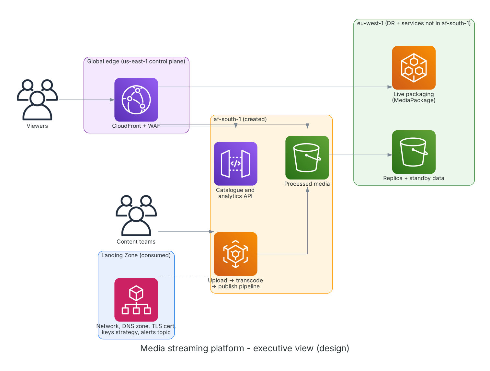
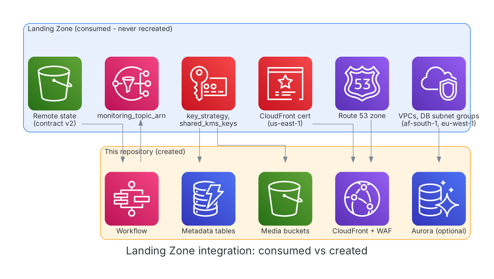
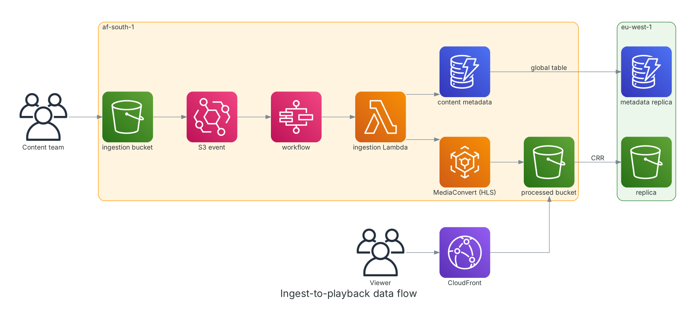
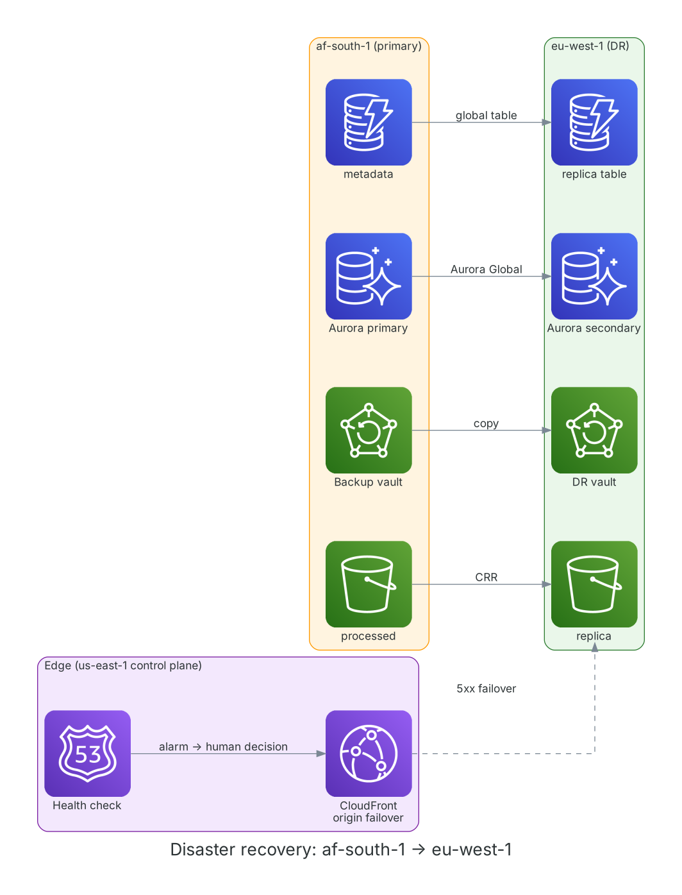

# aws-multi-region-media-streaming

Video-on-demand and live streaming platform for Africa-based audiences on AWS, built with Terraform. Uploads are transcoded to HLS, served through CloudFront, and cataloged through a small API. Primary region is Cape Town (af-south-1); Ireland (eu-west-1) is the DR region and hosts services Cape Town does not offer.

Everything shared (network, DNS zone, TLS certificate, key strategy, alerts topic) is **consumed from the AWS Enterprise Landing Zone** through remote state and never recreated.

## Executive architecture



## Landing Zone integration



Details and the gaps found in the Landing Zone export: [docs/landing-zone-integration.md](docs/landing-zone-integration.md).

## Ingest-to-playback data flow



## Disaster recovery



Targets RTO 4 h / RPO 15 min are design targets, not measured. Honest gap: compute (Lambda, API, workflow) is not pre-deployed in eu-west-1. See [docs/dr-and-resilience.md](docs/dr-and-resilience.md).

## Regions and the Ireland rule

| Region | Role |
|---|---|
| af-south-1 | Primary: S3, DynamoDB, MediaConvert, Lambda, API Gateway, Step Functions, Aurora primary |
| eu-west-1 | DR (replica bucket, DynamoDB replica, Aurora secondary, backup vault) **and MediaPackage, deployed from eu-west-1 (service not available in af-south-1)** |
| us-east-1 | Global-service control plane only: CloudFront, WAF (CLOUDFRONT scope), edge alarms. No workloads, not an approved deployment region |

Availability evidence and dates (checked 2026-11-05): [docs/regional-availability.md](docs/regional-availability.md).

## Encryption and FinOps

Development and Test environments use AWS-managed encryption keys to reduce AWS KMS operational costs and management overhead while maintaining encryption at rest. Production environments use Customer Managed Keys (CMKs) to satisfy governance, auditability, compliance, separation-of-duties, and enterprise security requirements.

Cost and key mapping: [docs/finops-and-kms.md](docs/finops-and-kms.md). **stage/prod will not plan until the Landing Zone exports CMKs** (its current `key_strategy` is `aws-managed`); this is a deliberate guard.

## Tech stack

Terraform >= 1.10 (AWS provider 5.x), MediaConvert, MediaPackage v1 (via CloudFormation), CloudFront with OAC and origin failover, WAFv2, API Gateway HTTP API, Lambda (Python 3.12, arm64), Step Functions, EventBridge, DynamoDB (global table), S3 with CRR, optional Aurora PostgreSQL Global Database, AWS Backup, CloudWatch.

## Repository layout

```
provider.tf            terraform block, backend, providers (default, ireland, global_edge)
landing_zone.tf        remote state, contract guard, key strategy locals
main.tf, variables.tf, outputs.tf
modules/               storage, media-convert, media-package, edge, database, api, workflow, monitoring, disaster-recovery
lambda/                content-api, analytics, media-ingestion, media-notification
tests/                 offline handler tests
environments/<env>/    backend.hcl.example, terraform.tfvars.example (dev, stage, prod)
scripts/               tf.sh (runner), generate-diagrams.py
architecture/diagrams  8 diagrams (blue = consumed, amber = created, green = eu-west-1, purple = global edge)
docs/                  ADRs, threat model, DR, FinOps/KMS, testing, roadmap, refactor notes
runbooks/              operations
```

## Deploying

```bash
cp environments/dev/backend.tf environments/dev/backend.tf            # Landing Zone state bucket
cp environments/dev/terraform.tfvars.example environments/dev/terraform.tfvars  # fill in
scripts/tf.sh dev init
scripts/tf.sh dev plan
```

The state bucket, key and region of the Landing Zone are inputs (`landing_zone_state_*`); they are not exported by the Landing Zone.

## Security and quality

WAF in front of the API and media, OAC-only private buckets, TLS-only policies, scoped IAM, JWT on write routes (set `jwt_issuer`), CI with tfsec, checkov, trivy, gitleaks and bandit. Threat model: [docs/threat-model.md](docs/threat-model.md). Testing: [docs/testing-strategy.md](docs/testing-strategy.md). Roadmap: [docs/roadmap.md](docs/roadmap.md).

---

## Author

**Emmanuel Mulenga** — Multi-Cloud Engineer
- 🌐 [](https://www.linkedin.com/in/emmanuel-mulenga)
💻 [](https://github.com/e-mulenga

---